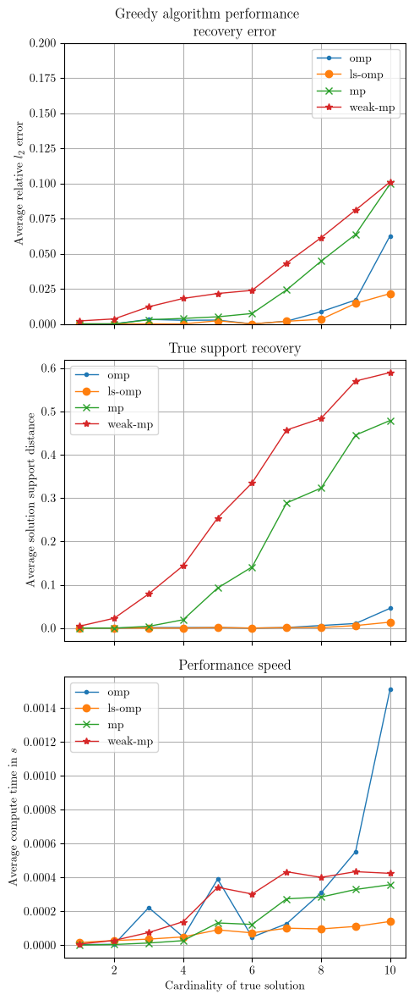
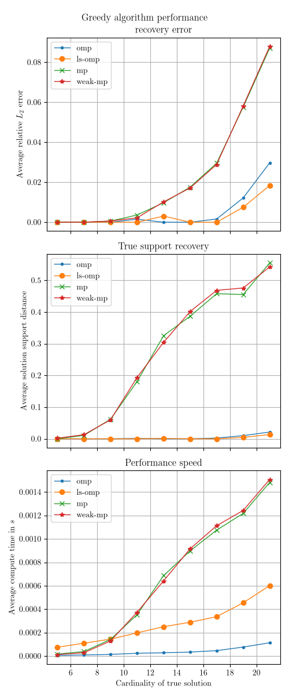

# Rep-rs
A repository for different algorithms for sparse recovery under linear constraints.
The problem formulation is given by:

$$\text{minimize}\ ||x||_0\\ \text{subject to}\ Ax = b$$ 

where $||x||_0$ is $l_0$-"norm" that returns the number of non-zero elements of $x$, $A\in\mathbb{R}^{n\times m}$, $b\in\mathbb{R}^n$ and $x\in\mathbb{R}^m$. Typically, $m>n$, i.e. the matrix $A$ is wide.

Different algorithms are provided in this repository.

## Performance
As a measurement of perfomance, we test the relative $l_2$ recovery error, given by

$$\frac{||x-\hat{x}||_2^2}{||x||_2^2}$$,

where $\hat{x}$ is the candidate solution and $x$ is the true solution, and the recovery of the support, given by

$$\frac{\text{max}\{|\hat{S}|,|S|\}-|\hat{S}\cap S|}{\text{max}\{|\hat{S}|,|S|\}}$$,

where $S$ is the true support set and $\hat{S}$ is the candidate support set and the time in seconds until the algorithm finishes.
The dimensions of $m$ and $n$ are given by $30\times 50$ and $60\times 100$ respectively

