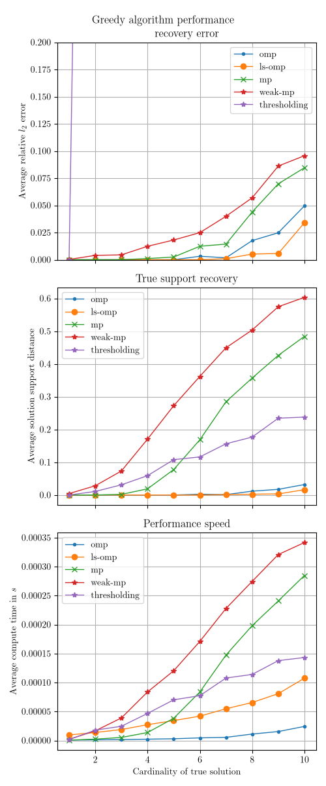

# Rep-rs
A repository with different algorithms for sparse recovery under linear constraints.
The problem formulation is given by:

$$\text{minimize}\ ||x||_0\\ \text{subject to}\ Ax = b$$ 

where $||x||_0$ is $l_0$-"norm" that returns the number of non-zero elements of $x$, $A\in\mathbb{R}^{n\times m}$, $b\in\mathbb{R}^n$ and $x\in\mathbb{R}^m$. Typically, $m>n$, i.e. the matrix $A$ is wide.

We provide different heuristic algorithms in this repository.

**Greedy algorithms**:
- Orthogonal-Matching-Pursuit (*omp*)
- Least-Squares-Orthogonal-Matching-Pursuit (*ls-omp*)
- Matching-Pursuit (*mp*)
- Weak-Matching-Pursuit (*weak-mp*)
- Thresholding (*thresholding*)

**Convex Relaxation Technique**:
- Iterative-Reweighed-Least-Squares (*irls*)

## Usage
```rust
use crate::mp::{Initializable, MpConfig, Solver};

mod inspection;
mod mp;

// Generate example setup with matrix-triple (a, x, b), where a@x = b.
let (a, x, b) = inspection::gen_ax_b(50, 100, 15);
// Initialize matching pursuit config with nessecary parameters.
let conf = MpConfig::init(
  &a,
  &b,
  1.0e-6, // Stops as soon as ||A@x_cand - b|| < threshold.
  10, // expected cardinality of solution, used for preemptive memory allocation.
);

// Initialize Orthogonal-Matching-Pursuit solver.
let mut problem = mp::Omp::init(&conf);
// Greedily solve the problem.
// Returns None if b lies in nullspace of a.
if let Some(x_cand) = problem.solve() {
  // Check performance of candidate solution:
  let l2_error = inspection::calc_solution_l2_error(&x, &x_cand);
  let support_dist = inspection::calc_solution_support_dist(&x, &x_cand);
  println!("l2 error: {l2_error:.4e}");
  println!("support distance: {support_dist:.4e}");
}
```

## Performance
All algorithms use the "faer" crate for linear algebra operations.

As a measurement of perfomance, we test the relative $l_2$ recovery error, given by

$$\frac{||x-\hat{x}||_2^2}{||x||_2^2}$$,

where $\hat{x}$ is the candidate solution and $x$ is the true solution, and the recovery of the support, given by

$$\frac{\text{max}\\{|\hat{S}|,|S|\\}-|\hat{S}\cap S|}{\text{max}\\{|\hat{S}|,|S|\\}}$$,

where $S$ is the true support set and $\hat{S}$ is the candidate support set and the time in seconds until the algorithm finishes.
The dimensions of $m$ and $n$ are given by $30\times 50$ and $60\times 100$ respectively




## Disclaimer
The algorithms are taken from the book "Sparse and Redundant Representation" written by Michael Elad.
